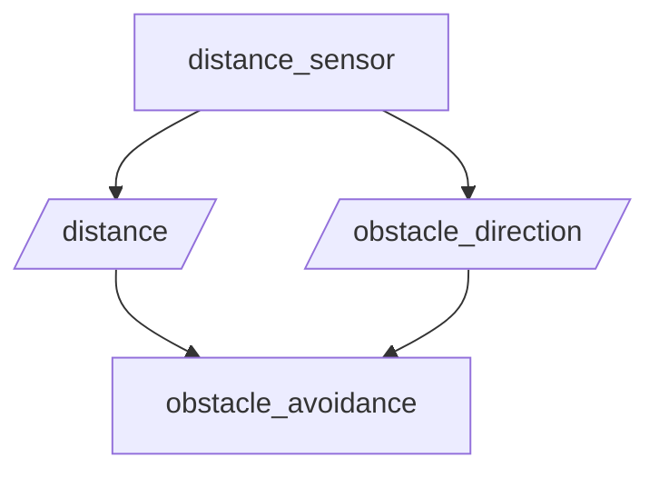

# ROS 2 Obstacle Avoidance

## A projekt célja

A projekt egy egyszerű, ROS 2 Humble és Python alapú akadályelkerülési szimulációt valósít meg. A rendszer szimulált távolságadatokat és akadálypozíciót generál, majd ezek alapján meghatározza a robot javasolt mozgását.

## Node-ok

### 1. distance_sensor

A `distance_sensor` node véletlenszerű adatokat generál:

- Az akadály távolsága 5 és 200 cm közötti.
- Az akadály helyzete `left`, `center` vagy `right` lehet.
- Az adatokat két másodpercenként publikálja.

### 2. obstacle_avoidance

Az `obstacle_avoidance` node feliratkozik a távolságot és az akadály helyzetét közvetítő topicokra. Ezek alapján meghatározza a robot javasolt döntését.

A döntési szabályok:

- 100 cm felett: `Continue`
- 10 cm felett, legfeljebb 100 cm-nél:
  - Bal oldali akadály esetén: `Steer right`
  - Jobb oldali akadály esetén: `Steer left`
  - Középen lévő akadály esetén: véletlenszerűen `Steer left` vagy `Steer right`
- 10 cm-nél vagy annál kisebb távolság esetén: `Stop`

## ROS 2 topicok

| Topic | Üzenettípus | Feladat |
|---|---|---|
| `/distance` | `std_msgs/msg/Float32` | Távolság centiméterben |
| `/obstacle_direction` | `std_msgs/msg/String` | Az akadály helyzete |

Mindkét topicot a `distance_sensor` publikálja, az `obstacle_avoidance` pedig feliratkozik rájuk.

## Fordítás

A ROS 2 munkaterület gyökérmappájában:

```bash
cd ~/ros2_ws
colcon build --packages-select tom_x4u --symlink-install
source install/setup.bash
```

## Futtatás

Az első terminálban:

```bash
source ~/ros2_ws/install/setup.bash
ros2 run tom_x4u distance_sensor
```

A második terminálban:

```bash
source ~/ros2_ws/install/setup.bash
ros2 run tom_x4u obstacle_avoidance
```

## Topicok ellenőrzése

A topicok listázása:

```bash
ros2 topic list
```

A távolságadatok megjelenítése:

```bash
ros2 topic echo /distance
```

Az akadály helyzetének megjelenítése:

```bash
ros2 topic echo /obstacle_direction
```

## Node–topic diagram


