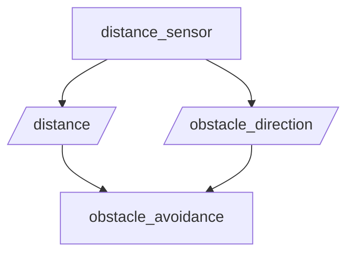

# ROS 2 Obstacle Avoidance

This project is a small ROS 2 Humble application that simulates a distance sensor and a simple obstacle avoidance system.

The package contains two nodes:

- **`distance_sensor`** – generates simulated distance measurements and obstacle directions.
- **`obstacle_avoidance`** – subscribes to the sensor data and makes a decision based on the distance and obstacle direction.

## Nodes and topics

### `distance_sensor`

This node generates simulated sensor data every two seconds.

It publishes:

| Topic | Message type | Description |
|---|---|---|
| `/distance` | `std_msgs/msg/Float32` | Simulated distance in centimeters |
| `/obstacle_direction` | `std_msgs/msg/String` | Obstacle direction: `left`, `center` or `right` |

The distance is randomly generated between 5 and 200 cm. The obstacle direction is randomly selected.

### `obstacle_avoidance`

This node subscribes to `/distance` and `/obstacle_direction`.

It makes a decision based on the received data:

- Distance greater than 100 cm: `Continue`
- Distance greater than 10 cm and at most 100 cm: `Steer left` or `Steer right`, depending on the obstacle direction
- Distance at most 10 cm: `Stop`

When the obstacle is in the center, the node selects a turning direction randomly.

## Node-topic diagram



## Build instructions

Open a terminal and navigate to the ROS 2 workspace:

```bash
cd ~/ros2_ws
```

Build the package:

```bash
colcon build --packages-select tom_x4u --symlink-install
```

Source the workspace:

```bash
source ~/ros2_ws/install/setup.bash
```

## Running the nodes

The launch file starts both nodes with one command:

```bash
ros2 launch tom_x4u tom_x4u.launch.py
```
